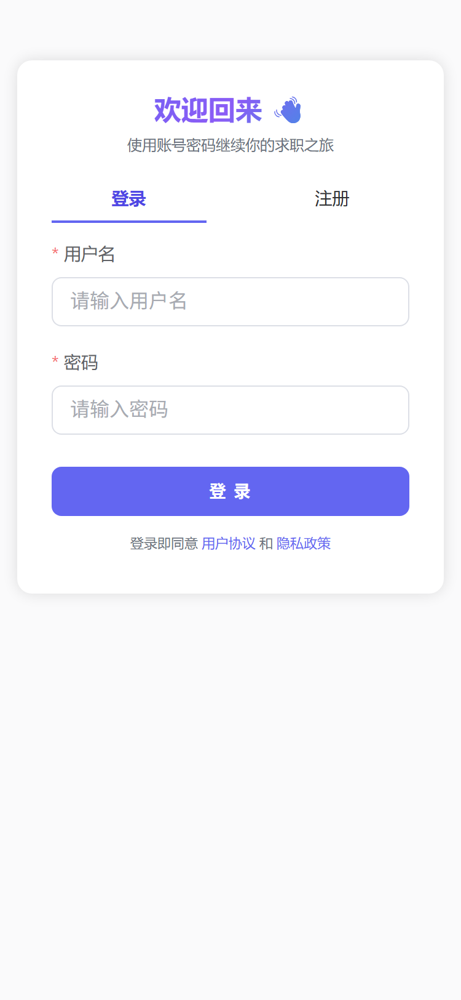
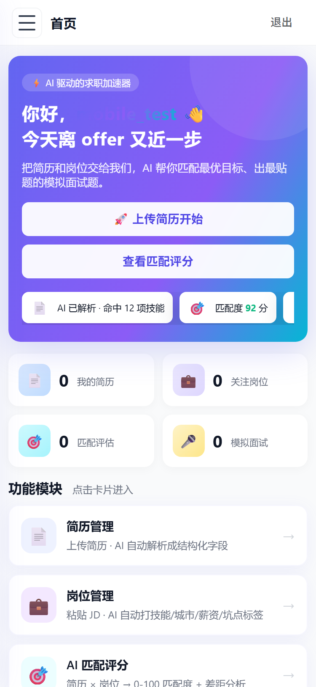
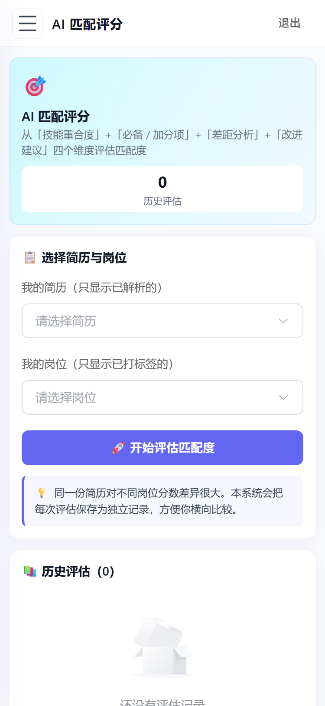
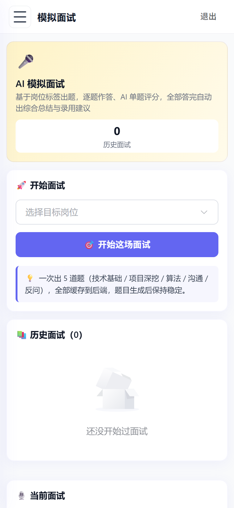
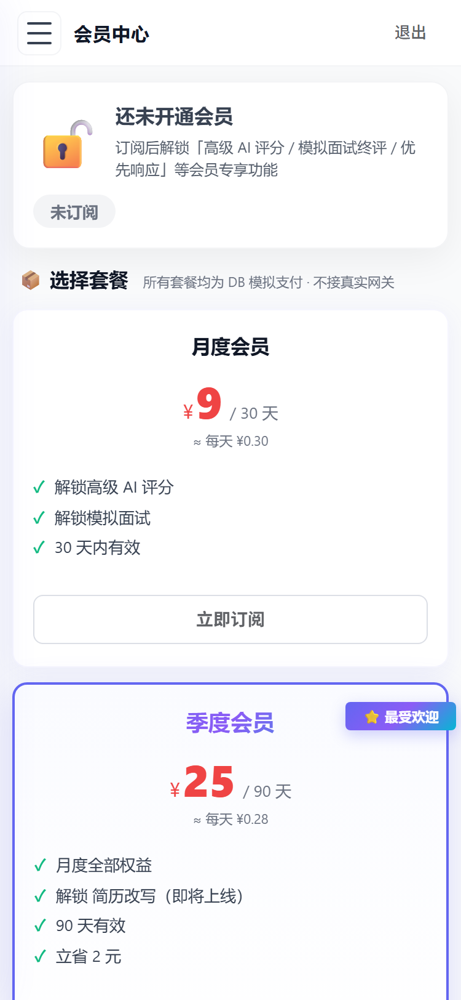

# AI 校招助手

面向秋招场景的全栈 Web 应用：把简历和岗位 JD 交给大模型做结构化解析，自动算出匹配度并给出改进建议，还能按岗位模拟面试。

后端 Spring Boot 3 + MyBatis-Plus + Spring Security/JWT，前端 Vue 3 + Element Plus，AI 能力基于 DeepSeek（OpenAI 兼容协议）。已做移动端适配，手机浏览器可直接使用。

<p align="center">
  
  
  
  
  
</p>
<p align="center"><sub>登录 · 首页 · 匹配评分 · 模拟面试 · 会员</sub></p>

## 功能

| 模块 | 做什么 |
|---|---|
| 简历解析 | 粘贴简历文本，AI 抽取出姓名、学校、项目经历、技能等结构化信息 |
| 岗位管理 | 粘贴 JD，AI 抽取岗位名、公司、城市、薪资、必备与加分技能 |
| 匹配评分 | 选一份简历 + 一个岗位，AI 给出 0-100 分、匹配亮点、能力差距和改进建议 |
| 模拟面试 | 按岗位一次性生成 5 道题，逐题作答并即时评分，全部答完给整体评价 |
| 会员订阅 | 三档套餐、下单、支付、续费（支付为数据库模拟，未接真实支付渠道） |

## 技术栈

| 层 | 选型 |
|---|---|
| 后端 | Spring Boot 3.3.4 · MyBatis-Plus 3.5.7 · Spring Security 6 + JWT |
| 数据库 | H2（默认，零配置启动）· MySQL（`--spring.profiles.active=mysql`） |
| AI | DeepSeek `deepseek-chat`，OpenAI 兼容接口，手写轻量客户端（不依赖额外 SDK） |
| 前端 | Vue 3.5 · Vite 5 · Element Plus · Pinia · Axios |
| 部署 | 前后端打成一个 jar，前端静态资源内嵌，一条命令启动 |

## 实现上的几个取舍

**1. AI 的输出必须能被程序解析，而不只是"看着对"**

四类任务全部走 JSON 模式（`response_format=json_object`）并把温度压到 0.2；提示词里固定字段名；返回后再做一次清洗，去掉模型可能套上的 Markdown 代码块。如果仍然解析失败，就把这条记录标成 `FAILED` 并保留原文，用户可以重试 —— 而不是让用户的内容随一次失败的调用一起丢掉。

**2. 先落库，再调 AI**

简历和 JD 都是先以 `PARSING` 状态入库，再发起模型调用，成功改 `PARSED`、失败改 `FAILED`。AI 调用是不可靠的外部依赖，不能让它决定数据要不要存在。

**3. 内容指纹去重**

JD 入库时对原文算 SHA-256，配合 `(user_id, raw_text_hash)` 联合索引判重。同一份 JD 不会重复调用模型，既省钱也省等待时间。用 hash 而不是原文比对，是因为 CLOB 比较慢，且换行符差异会导致"看着一样却不相等"。

**4. 越权从设计上堵住**

接口不接受前端传 `userId`，当前用户一律从 JWT 里取。前端传什么都没用。

**5. 金额以"分"为单位存整数**

避免浮点误差（`0.1 + 0.2 != 0.3`）。

## 项目结构

```
.
├── campus-recruit-ai/                  后端
│   └── src/main/java/com/campusrecruit/ai/
│       ├── ai/                         四类任务的提示词（简历/岗位/匹配/面试）
│       ├── client/                     DeepSeekClient：调模型、清洗返回、错误分类
│       ├── config/                     安全配置、JWT、MyBatis-Plus
│       ├── entity/ mapper/ service/ web/
│       └── dto/
├── campus-recruit-web/                 前端
│   └── src/
│       ├── views/                      7 个页面
│       ├── components/                 布局外壳、通用组件
│       ├── api/ stores/ router/
│       └── assets/styles/              全局样式与移动端适配
└── docs/screenshots/
```

## 本地运行

**1. 后端**

```bash
cd campus-recruit-ai
```

在同目录新建 `.env`（该文件已被 git 忽略）：

```
DEEPSEEK_API_KEY=你的 DeepSeek API Key
JWT_SECRET=至少32字节的随机字符串
```

然后启动：

```bash
mvn spring-boot:run
```

后端跑在 `http://localhost:8080`，首次启动会自动建表并写入演示数据。

**2. 前端**

```bash
cd campus-recruit-web
npm install
npm run dev
```

打开 `http://localhost:5173`，开发服务器已把 `/api` 代理到 8080。

**3. 打成单个 jar（可选）**

仓库里不存构建产物，需要单 jar 部署时自己 build 一次：

```bash
cd campus-recruit-web && npm run build

# 把前端产物拷到后端，再由 Maven 打进 jar
rm -rf ../campus-recruit-ai/src/main/resources/static
cp -r dist ../campus-recruit-ai/src/main/resources/static

cd ../campus-recruit-ai && mvn clean package
java -jar target/campus-recruit-ai-0.0.1-SNAPSHOT.jar
```

启动后访问 `http://localhost:8080` 就是完整应用（前端由后端直接托管）。

## 已知限制

- 支付是数据库模拟实现（订单状态机 + 事务），没有接支付宝/微信，因为没有商户资质
- 演示环境用 H2；生产要换 MySQL，并建议加 Redis 缓存热点匹配结果
- 没有做接口限流和熔断，AI 接口在高并发下会先成为瓶颈
- 解析和评分质量取决于提示词与模型能力，不保证与人工判断一致
